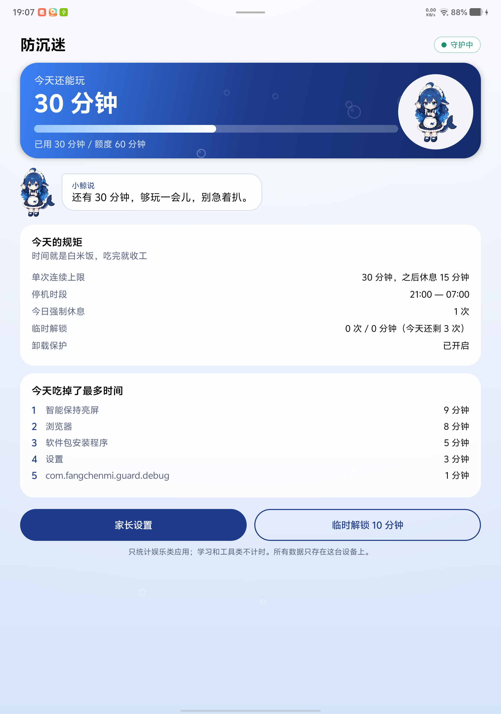

# 小鲸守护

给孩子的平板按家长定的规则限时。纯本地运行，不联网、不上传任何数据。



## 下载

最新版：[**下载 免费版 v1.3.5**](https://github.com/ymck-x/xiaojing-guard/releases/download/v1.3.5/xiaojing-guard-1.3.5-free.apk)（6.8 MB，Android 8.0+）

安装步骤：

1. 点开下载的 APK，允许「安装未知来源应用」。
2. 部分机型（ColorOS / OriginOS）会提示「受限制的设置」，需要去应用信息页解除，否则无障碍开不起来。
3. 首次启动会请求「读取已安装应用列表」，用于让家长逐个分类应用，点允许即可。
4. 按引导三步完成：设密码 → 开无障碍 → 开守护。

> **装好之后桌面图标会自己消失**，这是有意设计的：孩子找不到卸载入口。家长从通知栏「小鲸守护正在运行」进应用；被锁屏时也可以在屏幕右下角连点 5 下。

**升级提示**：覆盖安装后系统会清空无障碍授权，应用会推送一条「小鲸守护已失效」的通知，点它重新开启即可。

## 免费版与付费版

免费版能真的「管住」——每日总时长、停机时段、整屏锁、家长密码、防卸载，一个不少。付费版卖的是「管得细」和「省心」。

| 功能 | 免费版 | 付费版（19.9 元） |
| --- | --- | --- |
| 每日总时长 + 到点整屏锁 | ✅ | ✅ |
| 停机时段（睡觉时间） | ✅ | ✅ |
| 家长密码 / 防卸载 / 失效提醒 | ✅ | ✅ |
| 学习类不计时 | ✅ | ✅ |
| 隐藏桌面图标 | ✅ | ✅ |
| 禁止名单 | 最多 3 个应用 | 不限 |
| 单应用限额（抖音每天 20 分钟） | ❌ | ✅ |
| 单次连续 + 强制休息（护眼） | ❌ | ✅ |
| 临时解锁 | 每天 1 次 × 10 分钟 | 每天 3 次，时长可调 |

付费版与免费版**同包名、同签名**，直接覆盖安装即可升级，已设好的规则和累计时长全部保留。

## 定价

一次性买断 **19.9 元**，含全部功能与后续版本更新。不订阅、不内购、不加广告。

购买入口有两个：

- 应用内「家长设置 → 升级到付费版 → 打开购买页」
- 作者的爱发电主页：**<https://afdian.com/a/ymck1>**

> 本项目由作者独立开发与维护，源码与发布记录见本仓库。

## 功能

| 规则 | 说明 |
| --- | --- |
| 每日可用时长 | 娱乐类应用累计用满就锁整台平板，第二天自动重置（重置时刻可设，默认零点） |
| 单次连续时长 | 连续玩满 N 分钟强制休息 M 分钟，避免一口气玩太久 |
| 停机时段 | 例如 21:00–07:00 整台平板锁死，跨零点支持 |
| 应用分类 | 每个应用可设为「学习（不计时）/ 娱乐（计额度）/ 禁止（打开就弹回）」 |
| 单应用限额 | 娱乐类应用可再单独设每日限额，比如抖音只给 20 分钟 |
| 禁止进入设置与管理工具 | 设置、i管家/安全中心、权限管理、应用商店、文件管理、手机互传——这些入口都能关掉守护或装应用，一律要密码 |
| 失效提醒 | 开机 / 应用更新 / 进程启动时自检：守护开着但无障碍授权被系统清掉了，立刻发通知「防沉迷已失效」 |
| 家长密码 | **8 位数字**，PBKDF2 加盐存储，明文不落盘；8 位是一亿种组合，配试错锁定基本不可能被暴力试开 |
| 临时解锁 | 家长验证密码后解锁一段固定时间（默认 10 分钟），期间**不拦截也不计时**——家长用平板不该烧孩子的额度；**每天有次数上限**（默认 3 次，可调），用完当天不再放行 |
| 密码试错保护 | 连续输错 5 次起开始锁：30 秒 → 1 分 → 2 分…翻倍，封顶 15 分钟；计数落盘，关掉密码框重开也不会清零 |
| 卸载保护 | 激活设备管理器后孩子无法直接卸载；家长可在应用内解除 |

计时逻辑：**只有娱乐类应用在「亮屏 + 前台」时才算时间**。桌面、系统界面、输入法、锁屏遮挡层都不计时。
学习和工具类应用完全不占额度、也不会触发休息。

## 外观：小鲸主题

界面用的是 B 站「鱼灾」那波 **小鲸 / 大肥鱼** 的视觉语言：深海军蓝 + 亮蓝 + 白围裙 + 金币色，
家长端是浅海奶油蓝底，孩子端是深海底色。小鲸会按状态换表情——正常是挥手，额度只剩一点是惊讶，
时间用完是闭眼睡觉。台词也照它的口吻写（「时间被我吃光啦」「省着点用，别急着扒」）。

素材取自社区皮肤包 [roseion/dsh-dayu-fish-skin](https://github.com/roseion/dsh-dayu-fish-skin)，
其 [SOURCES.md](https://github.com/roseion/dsh-dayu-fish-skin/blob/main/SOURCES.md) 记录的最初出处为
[YunYueSama/codex-deepseek-pet](https://github.com/YunYueSama/codex-deepseek-pet)、
[1190fasheqi/dafeiyu-pet](https://github.com/1190fasheqi/dafeiyu-pet)、
[gmskywalker/deepseek-fat-fish-codex-pet](https://github.com/gmskywalker/deepseek-fat-fish-codex-pet)，
角色设定作者 @田中智。**这些是社区二创，原作者保留权利，仅可个人自用**。
如果要把它当产品分发给别人或上架应用商店，必须把这几个表情/立绘换成你自己有版权的美术资源，
代码部分（`ui/` 里的布局、配色、动画）不受影响。

## 装到平板上

1. 把 `fangchenmi-release.apk` 传到平板，点击安装（需要允许「安装未知来源应用」）。
2. 打开应用，按引导做三步：
   - 设置家长密码
   - 开启无障碍：设置 → 无障碍 → 防沉迷 · 使用守护
   - （建议）开启卸载保护
3. 定好规矩，点「开始守护」。

开启无障碍后回到应用，状态会自动刷新。**没有无障碍权限时，开关虽然能打开但拦不住任何东西**——这是本应用唯一的强制手段。

部分机型（尤其 ColorOS / OriginOS）侧的「安装未知来源」和「无障碍」会额外弹一次「允许受限制的设置」，需要在应用信息页里先解除限制。

## 孩子那边会怎样

- 打开被禁止的应用：弹出提示并立刻退回桌面。
- 单个应用额度用完：同上。
- 每日总时长用完 / 进入停机时段：整屏锁死，显示原因和「家长验证」入口。孩子点不到下面任何东西，也关不掉。
- 连续用满设定时长：锁屏显示休息倒计时，倒计时结束自动恢复。

## 家长要临时用一下

- 锁屏界面上点「家长验证」，输密码 → 按设定解锁（默认 10 分钟）。
- 或在应用首页点「临时解锁」（同样要密码）。
- 每天默认只给 3 次，用完按钮变灰、锁屏上输对密码也会提示次数已用完；第二天自动清零。
  嫌少可以在「家长设置 → 临时解锁 → 每天最多解锁次数」里调（0 = 不限，不建议：密码一旦泄露就没有上限了）。
- 需要长时间调整：解锁后进「家长设置」。
- 改密码：「家长设置 → 家长密码 → 修改」，固定 8 位、输满自动进入确认。
- 老版本留下的 4 位密码仍然有效（校验按存下来的位数走），设置页会提示「当前是 4 位，建议改成 8 位」，重设一次即可。

## 真机验证记录

在 1968×2800 的 Android 16 平板上逐条跑过：

| 场景 | 结果 |
| --- | --- |
| 引导：设密码 → 开无障碍 → 开守护 | 通过 |
| 应用规则页列出 233 个已装应用，可逐个分类 | 通过 |
| 打开系统「设置」 | 弹提示并退回桌面 |
| 每日额度用尽（600s / 600s） | 整屏锁死，遮挡层盖住状态栏 |
| 锁屏上输密码 | 解锁 10 分钟，首页显示「家长已临时解锁」 |
| 临时解锁到期 | 自动重新上锁 |
| 单次连续到点 | 显示「休息一下」并实时倒计时 |
| 正式包（release 签名）重跑拦截 | 通过 |
| 锁屏下拉通知栏 | 盖不住：窗口层级里遮挡层（type 2032）排在 NotificationShade（2040）之上，下拉无反应 |
| 锁屏按 HOME / 最近任务 | 盖不住，遮挡层原样保留 |
| 锁屏长按电源 | 关机菜单也在遮挡层下面，看不见 |
| i管家 / 文件管理 / 应用商店 | 打开即弹回桌面 |

## 解除守护 / 卸载

「家长设置 → 解除守护」：会关闭守护、取消卸载保护。之后可以正常卸载。
如果忘了密码：设备上无法自助恢复（这是设计使然）。用电脑执行 `adb shell dumpsys device_policy` 后
`adb shell dpm remove-active-admin com.fangchenmi.guard/.admin.GuardDeviceAdminReceiver` 可解除卸载保护，
再卸载重装。**没有电脑就只能恢复出厂设置**——请务必把密码记牢。

## 已知限制（这些绕不过去，先知道）

1. **依赖无障碍服务**。孩子如果能在设置里关掉它，防护立即失效。所以「禁止进入设置与管理工具」默认开启。
   注意：**应用被覆盖安装、系统升级后，系统会清空无障碍授权**，守护会静默失效——已用看门狗通知兜底，
   但换新版后仍要留意那条「防沉迷已失效」的通知。
2. **安全模式可绕过**。长按电源 → 关机 → 长按「关机」进入安全模式，第三方应用全部停用。要防这个，
   需要设备厂商级的管理员权限（Device Owner），普通侧载应用拿不到。
3. **恢复出厂设置当然也能解除**。
4. **换用系统自带的儿童空间 / 家庭守护会更彻底**（它们是系统权限）。本应用的价值是不用绑定厂商账号、
   规则更细（分应用限额、单次时长、停机时段可以一起用）。
5. 分屏、画中画等特殊窗口状态下，个别应用的前台识别可能滞后一两秒。
6. 无障碍事件来自系统，个别 ROM 在省电模式下可能冻结后台，建议把本应用加入「电池不受限」白名单。

## 开发

```
app/src/main/java/com/fangchenmi/guard/
  core/            纯逻辑，无 Android 依赖，可单元测试
    model/         GuardConfig、应用分类
    usage/         UsageMeter：计时状态机（纯函数 reducer）
    policy/        GuardPolicy：唯一判定入口
    time/          Days：日界与分时段计算
    pin/           PinHasher：PBKDF2
  data/            ConfigStore / UsageStore / PackageFacts / AppCatalog
  service/         GuardAccessibilityService（眼睛）、GuardEngine（执行中枢）、LockOverlay（锁屏遮挡层）
  admin/           卸载保护（DeviceAdmin）
  ui/              Compose 家长端界面
```

构建与测试：

```bash
./gradlew :app:testDebugUnitTest   # 核心逻辑单测
./gradlew :app:assembleDebug       # 调试包（包名带 .debug 后缀，可与正式版共存）
./gradlew :app:assembleRelease     # 正式包，用 keystore/ 下的自签名证书
```

设计约束（改代码前先读）：

- **判定只在 `GuardPolicy` 里做**。UI、无障碍服务、悬浮层都只消费它的结论，不允许各自实现一套规则。
- **计时只在 `UsageMeter` 里做**，它是纯函数，靠事件推移状态，因此跨日、跨零点、改系统时间这些边界都能单测。
- **锁屏遮挡层显示期间不计时**（`MeterState.paused`）。否则强制休息的十分钟会自己把休息额度又"玩"掉，死循环。
- 锁屏遮挡层用原生 View 构建，不走 Compose——它在拦截关键路径上，要保证快速、稳定。
- 「设置」的拦截必须在「忽略名单」之前判定。个别 ROM 把 `Settings$FallbackHome` 注册成桌面活动，
  顺序反了会让设置进入忽略名单，导致孩子能自己关掉守护。
- **全局锁对自己的应用也生效**。锁定遮挡层一显示，系统就会产生「前台 = 本应用」的无障碍事件；
  若对自己的包放行全局锁，锁屏会在显示的第一秒把自己拆掉。家长通过锁屏上的「家长验证」进设置。

## 签名

自签名证书在 `keystore/fangchenmi.jks`（口令见 `keystore/keystore.properties`）。
升级安装必须用同一个签名，否则系统会拒绝覆盖安装。

## 另一个应用：还原（restore）

同一个仓库里的第二个应用，给孩子的平板用：**每天到点把新装的应用收回去，白名单除外**。

- 代码：`restore/`（`:restore` 模块，包名 `com.fangchenmi.restore`）
- 说明：`restore/README.md`
- 正式包：`dist/huanyuan-1.0.apk`
- 与防沉迷共用同一张签名证书，两个应用可以同时装